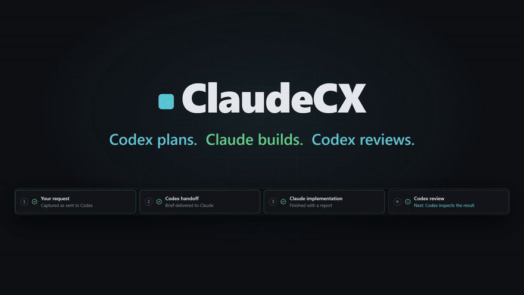
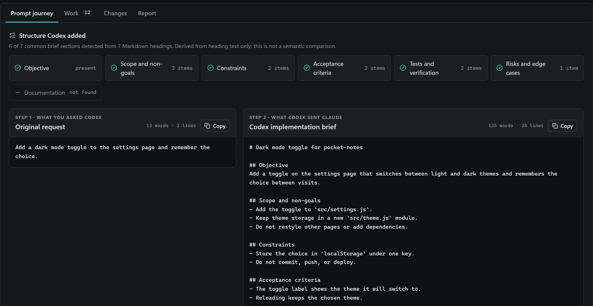
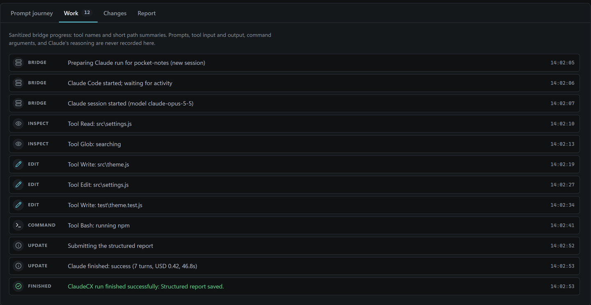
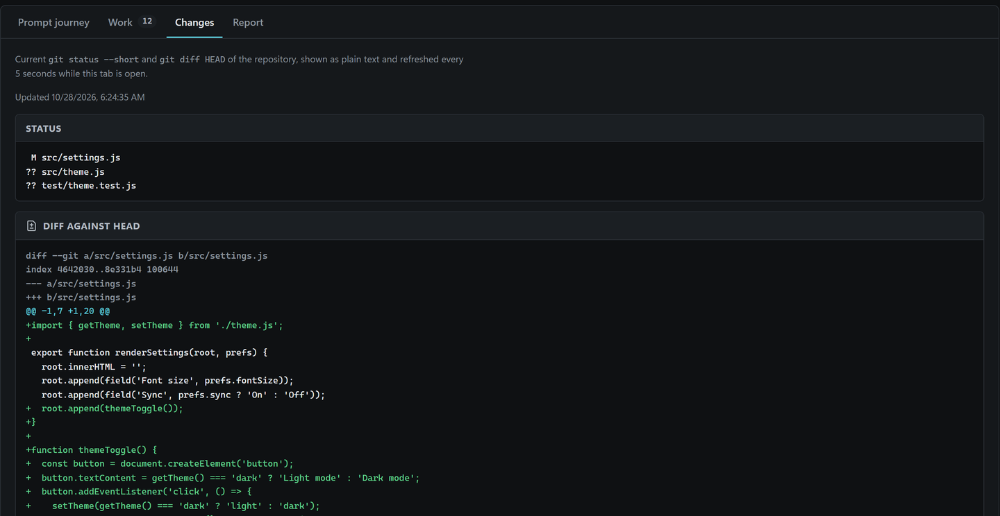
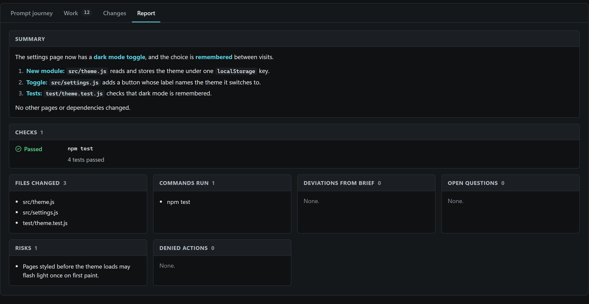

# ClaudeCX

[](docs/assets/claudecx-tour.mp4)

<p align="center"><a href="docs/assets/claudecx-tour.mp4"><b>▶ Watch the 21-second tour</b></a> (shown on a demo project, with sound)</p>

ClaudeCX lets **Codex** (OpenAI's coding agent) hand coding work to **Claude Code** (Anthropic's coding agent) and then check the result.

- **Codex plans and reviews.** It reads your project, writes a precise task description for Claude (the *brief*), checks every change Claude makes, and runs your tests itself.
- **Claude Code writes the code.** It edits files in your project and returns a structured report of what it did. It never commits, pushes, or deploys.
- **A guarded bridge sits between them.** A PowerShell script starts Claude with fixed safety settings and limits, watches the run, and refuses anything suspicious.
- **You watch it live.** A dashboard opens in your browser while Claude works, with a **Stop run** button.

You start it on purpose by typing `$claudecx` in a Codex chat. Codex never uses it on its own.


<details>
<summary>Text version of the diagram</summary>

```text
 You ──"$claudecx add a login page"──▶ Codex
                                         │ 1. reads your project, writes a brief
                                         ▼
                               ClaudeCX bridge (PowerShell)
                     checks Git · locks the repo · fixed safety flags · limits
                                         │ 2. starts Claude with the brief
                                         ▼
                                   Claude Code ──edits files──▶ your Git repository
                                         │ 3. structured report
                                         ▼
                                       Codex
                     4. reviews the real diff, runs your tests, asks Claude for fixes
                                         │
                                         ▼
                                  You review and commit
```

</details>

> **Warning:** ClaudeCX is defense in depth, **not a host sandbox**. Claude runs as your Windows user, with your files and your network. Its blocked-command rules match command text, so a confused agent can get around them. Your project's own build and test scripts (`npm test`, `make`, `pytest`, and so on) can run any code. Use ClaudeCX only on projects whose scripts you trust or have read. See [SECURITY.md](SECURITY.md).

## Contents

1. [What you need](#1-what-you-need)
2. [Setup, step by step](#2-setup-step-by-step)
3. [Your first run](#3-your-first-run)
4. [Writing good requests](#4-writing-good-requests)
5. [The live dashboard](#5-the-live-dashboard)
6. [What happens during a run](#6-what-happens-during-a-run)
7. [Limits and options](#7-limits-and-options)
8. [Follow-ups and resuming a session](#8-follow-ups-and-resuming-a-session)
9. [Logs and where to find them](#9-logs-and-where-to-find-them)
10. [What is protected, and what is not](#10-what-is-protected-and-what-is-not)
11. [Updating, reinstalling, and uninstalling](#11-updating-reinstalling-and-uninstalling)
12. [Troubleshooting](#12-troubleshooting)
13. [Glossary](#13-glossary)
14. [For maintainers](#14-for-maintainers)

## 1. What you need

**Windows only.** ClaudeCX v1 supports Windows 10 and 11. macOS and Linux are not supported or tested.

### Accounts

| Account | Used for |
| --- | --- |
| An OpenAI account that can use **Codex** (for example a ChatGPT plan that includes Codex) | Codex plans, reviews, and talks to you. Its usage counts against your OpenAI plan. |
| An Anthropic account that can use **Claude Code** (a Claude subscription such as Pro or Max, or an Anthropic API key) | Claude writes the code. Its usage counts against your Claude plan or API billing. |

Each ClaudeCX run uses **both**: Codex's usage for planning and review, and Claude's usage for the implementation.

### Software

| Software | Why | How to check it is installed |
| --- | --- | --- |
| **Git** | ClaudeCX only works inside Git repositories. | `git --version` |
| **PowerShell 7.2 or later** (`pwsh`) | The installer, the bridge, and the tests are PowerShell 7 scripts. This is not the built-in *Windows PowerShell 5.1*. | `pwsh --version` |
| **Codex** with skills support: the Codex desktop app, the Codex CLI, or the Codex IDE extension | Runs the `$claudecx` skill. | Codex opens and you can chat with it. For the CLI: `codex --version` |
| **Claude Code**, signed in | Does the implementation. | `claude --version` and `claude auth status` |

Claude Code must support `--safe-mode`, `--output-format stream-json`, `--json-schema`, and the `auto` permission mode. ClaudeCX was tested with Claude Code 2.1.311. Older versions may lack these options.

## 2. Setup, step by step

Do these steps once per computer. Run the commands in a normal terminal (Windows Terminal or PowerShell).

> **Rather let an AI agent do it?** Give Codex, Claude Code, or another coding agent this repository and ask it to set ClaudeCX up. It follows [docs/AGENT-SETUP.md](docs/AGENT-SETUP.md), checks the result with `doctor.ps1`, and tells you which steps need you (signing in to Claude and Codex).

### Step 1: Install Git

Skip this if `git --version` already prints a version.

```powershell
winget install --id Git.Git -e --source winget
```

Close and reopen the terminal afterwards so the `git` command is found.

### Step 2: Install PowerShell 7

Skip this if `pwsh --version` already prints `PowerShell 7.2` or later.

```powershell
winget install --id Microsoft.PowerShell -e --source winget
```

Close and reopen the terminal, then check:

```powershell
pwsh --version
```

> The Codex desktop app ships its own copy of PowerShell 7 and uses it for its commands, so Codex can run the bridge even without this step. You still need your own PowerShell 7 to run the installer and the tests yourself.

### Step 3: Install Codex and sign in

Install Codex by following OpenAI's instructions at <https://developers.openai.com/codex>. Any of these works: the Codex desktop app, the Codex CLI, or the Codex extension for your editor. Open it once and sign in with your OpenAI account.

### Step 4: Install Claude Code and sign in

Install Claude Code by following Anthropic's instructions at <https://code.claude.com/docs/en/setup>. Then sign in by starting it once in a terminal:

```powershell
claude
```

Follow the sign-in prompts, then exit Claude (type `/exit`). Check that it worked:

```powershell
claude --version
claude auth status
```

`claude auth status` must report that you are signed in. Codex must be able to find the `claude` command, so make sure `claude --version` works in a new terminal.

### Step 5: Download ClaudeCX

Pick a folder for it (any folder works; it does not need to stay next to your projects), then:

```powershell
git clone https://github.com/Jadessz/ClaudeCX.git
cd ClaudeCX
```

> **Downloaded the ZIP instead?** Windows marks every file in it as coming from the internet, and PowerShell then refuses to run them ("is not digitally signed"). Unblock them once, inside the extracted folder:
>
> ```powershell
> Get-ChildItem -Recurse | Unblock-File
> ```

### Step 6: Install the skill into Codex

```powershell
pwsh -NoProfile -File .\install.ps1
```

The installer:

1. checks that the skill files in the repository are complete and valid;
2. copies them to `<CodexHome>\skills\claudecx`;
3. checks that the copy matches the original exactly;
4. unblocks the installed copy, so Codex can run it even if you downloaded a ZIP;
5. prints the next step;
6. runs the setup check ([Step 8](#step-8-check-your-setup)) and lists anything still missing, with how to fix it.

`<CodexHome>` is, in this order: the `-CodexHome` value if you pass one, otherwise the `CODEX_HOME` environment variable, otherwise `%USERPROFILE%\.codex`. Most people never set either, so the skill lands in `%USERPROFILE%\.codex\skills\claudecx`.

If ClaudeCX is already installed, the installer stops and tells you to use `-Force` (see [Updating](#11-updating-reinstalling-and-uninstalling)). It never changes your Claude settings unless you ask for it with `-DisableClaudeAttribution` (next step).

### Step 7 (optional): Stop Claude from adding itself to your commits

When you commit with Claude Code yourself, it normally adds a "Co-Authored-By: Claude" line and similar notes. ClaudeCX already turns these off for its own runs. To turn them off for your own interactive Claude sessions too:

```powershell
pwsh -NoProfile -File .\install.ps1 -Force -DisableClaudeAttribution
```

This changes only `attribution.commit`, `attribution.pr`, and `attribution.sessionUrl` in `%USERPROFILE%\.claude\settings.json` (or `CLAUDE_CONFIG_DIR\settings.json`, or the file you pass with `-ClaudeSettingsPath`). Every other setting is kept, and the original file is saved first as `settings.json.claudecx-backup-<timestamp>`. The file must be strict JSON (no comments, no trailing commas).

### Step 8: Check your setup

The installer already ran this check. Run it again any time something seems wrong:

```powershell
pwsh -NoProfile -File .\doctor.ps1
```

It checks, without changing anything: Windows, PowerShell, blocked downloads, Git, Claude Code (found, new enough, signed in), Codex, the installed skill, the folder for run logs, and a default browser for the dashboard. Every problem comes with a **Fix** line. When everything is fine, it ends with:

```text
Ready: ClaudeCX can run on this computer.
```

Add `-Json` for a machine-readable report (agents use this).

Optionally, run the offline self-tests too. They use temporary folders and never touch your real Codex or Claude configuration:

```powershell
pwsh -NoProfile -File .\scripts\test-static.ps1
pwsh -NoProfile -File .\scripts\test-install.ps1
```

Each one ends with a line such as `test-static: all ... checks passed`.

### Step 9: Restart Codex

**Open a new Codex chat** (or restart the Codex app or CLI if it was already running) so it picks up the new skill. Setup is done.

## 3. Your first run

### Prepare the project

ClaudeCX needs a Git repository with **at least one commit** and **no uncommitted changes**, including no new, untracked files. That way, every change after the run is known to be Claude's.

In a terminal inside your project:

```powershell
git status
```

It must say `nothing to commit, working tree clean`. If it doesn't, commit your work (`git add -A` and `git commit -m "..."`) or stash it (`git stash -u`) first. If the folder is not a Git repository yet, run `git init`, then `git add -A` and `git commit -m "Initial commit"`.

### Ask Codex

Open a Codex chat **in your project folder** and type `$claudecx` followed by what you want:

```text
$claudecx Add server-side validation for the email and password fields in
src/routes/signup.ts, return 400 with a field-level error map, and add unit
tests in tests/signup.test.ts. Run `npm test` afterwards.
```

You must type `$claudecx` exactly. Codex never starts ClaudeCX unless you ask for it.

### What you will see

1. **Codex reads your project** and writes a brief for Claude. The brief is saved outside your repository.
2. **Codex may ask permission** to run the bridge command, depending on your Codex approval settings. Approve it. The bridge needs network access (Claude talks to Anthropic's servers) and must write logs outside your project folder.
3. **The dashboard opens in your default browser** and shows Claude's progress live (see [the live dashboard](#5-the-live-dashboard)). Codex's chat stays quiet while it waits; this is normal.
4. **Claude finishes.** The dashboard shows *Succeeded*, *Failed*, or *Stopped*.
5. **Codex reviews.** It reads Claude's report, then checks the real `git status` and diff itself, and runs your tests itself. If something is wrong, it sends a follow-up to the same Claude session and the dashboard opens again for that turn.
6. **Codex reports back:** what changed, what it checked, and any remaining risk.
7. **You decide.** Review the changes (`git diff`), then commit them yourself, or ask Codex to commit them. Nothing is committed or pushed automatically.

Don't edit the project yourself while a run is active. Only one writer at a time.

## 4. Writing good requests

Codex turns your request into the brief, so a clear request gives a better result. Say:

- **what** you want, as an observable result ("the signup form rejects invalid emails with a message under the field");
- **where**, if you know (files, folders, functions);
- **what not to touch** ("don't change the database schema");
- **how to check it** ("add tests and run `npm test`").

You can also set limits in plain words, and Codex passes them to the bridge:

```text
$claudecx Fix the date formatting bug in reports/export.py and add a regression
test. Keep it small: at most 20 turns and a 2 dollar budget.
```

One task per request works best. Split large features into several runs.

## 5. The live dashboard

While Claude works, the bridge opens a local **Dashboard** in your default browser at `http://127.0.0.1:<random port>/`. This is the default (`-ProgressMode Dashboard`). It is a small page served by a separate PowerShell process on your own computer. It has no build step, loads nothing from the internet, and makes no network calls beyond your own machine.

<table>
  <tr>
    <td width="50%"><a href="docs/assets/dashboard-journey.png"></a><br><b>Prompt journey</b>: your request beside the brief Codex wrote.</td>
    <td width="50%"><a href="docs/assets/dashboard-work.png"></a><br><b>Work</b>: every step Claude takes, as it happens.</td>
  </tr>
  <tr>
    <td width="50%"><a href="docs/assets/dashboard-changes.png"></a><br><b>Changes</b>: the real <code>git status</code> and diff.</td>
    <td width="50%"><a href="docs/assets/dashboard-report.png"></a><br><b>Report</b>: Claude's summary, checks, and risks.</td>
  </tr>
</table>

<sub>Screenshots from a demo project. Click any image to see it full size.</sub>

### What it shows

- **Command bar** (stays at the top): the repository name, the run status (*Running*, *Succeeded*, *Failed*, *Stopped*), elapsed time, whether the page is connected, and the Refresh, Copy session, and Stop run buttons.
- **Current state:** one headline for what is happening now, the latest activity or final outcome, and a single row of facts: session, start time, turns, cost, and duration against their limits.
- **Collaboration flow:** *Your request → Codex handoff → Claude implementation → Codex review*. Codex review is always shown as next, never as done, because it happens after the run.
- **Prompt journey tab** (the default): your original request to Codex and the exact brief Codex sent Claude, side by side as plain text, each with its own Copy button, plus a short outline of the structure Codex added (objective, scope, constraints, acceptance criteria, tests, risks, docs) detected from the brief's Markdown headings. The outline is a literal heading match, not an AI comparison. If Codex did not pass `-OriginalPromptPath` (older or manual calls), the page says the original request was not captured; everything else works.
- **Work tab:** what Claude is doing, one short line per step, shown as a timeline that follows the latest step (scroll up to pause following), for example `Tool Edit: src\routes\signup.ts` or `Tool Bash: running command`. This is the text of `progress.log`. It never shows prompts, file contents, command arguments, search text, or URLs.
- **Changes tab:** the current `git status --short` and the full diff of your repository against `HEAD`, as plain text, capped at 2 MiB (a warning appears if it is cut off).
- **Report tab:** Claude's final structured report (summary, changed files, checks, commands, denied actions, open questions, deviations from the brief, risks), or the reason the run failed or was stopped.

### Controls

The run controls are **Refresh**, **Copy session**, and **Stop run**; the prompt journey also has a **Copy** button for each prompt.

**Stop run** works only while the run is active and asks you to confirm. After you confirm:

1. the dashboard server writes `stop-request.json` into the run folder, and the button changes to `Stop requested…`;
2. the bridge, which checks about four times a second, terminates Claude and every process Claude started;
3. the run is recorded as *stopped*, and the bridge exits with an error so Codex knows.

**Stop run does not undo anything.** Edits Claude already made stay in your project for review. Review them with `git diff`, then keep them or discard them (`git restore .` and `git clean -fd`, which delete Claude's uncommitted changes for good). A stopped session cannot be resumed once Claude has changed files.

There is no pause, steering, approve/reject, commit, push, or deploy control. The dashboard cannot read arbitrary files or run commands.

### Good to know

- Closing the browser tab **does not stop Claude**.
- The brief and the original request must be files **outside** your project (Codex writes them next to each other in a temporary folder). The bridge copies them into the run folder, so they stay on disk with the other logs until you delete that folder.
- The dashboard never shows Claude's role prompt, raw event stream, reasoning, tool input or output, command arguments, search text, or hosts.
- The page is a prebuilt static bundle shipped with the skill. You do not need Node or npm, and it loads nothing from the internet.
- **Don't reload the page.** The access key lives only in the open tab, so a reload loses the connection. The run continues, and its progress stays in `progress.log`.
- The dashboard server shuts itself down a few minutes after the run ends (after about 3 minutes with the page closed, at most 15 minutes), as soon as the bridge disappears, or at a hard time limit.
- Only your own computer can reach it. It listens on `127.0.0.1` only, and each run uses a new random 256-bit access key. The key reaches the browser in the address after `#` (which browsers never send to servers), is removed from the address bar at once, and is never written to disk, logs, or your project. See [SECURITY.md](SECURITY.md#local-dashboard).
- The Changes and Report tabs show your real code and Claude's report text. Treat the page like your editor: anyone who can see your screen can read it.

### Other progress modes

If the dashboard cannot start (for example, no default browser is set), the bridge prints a one-line warning and falls back to a progress window, and if that fails too, to text output. Fallbacks change only where progress is shown, never how Claude runs.

You can also ask Codex for a specific mode, or pass it yourself:

| Mode | What you see |
| --- | --- |
| `-ProgressMode Dashboard` (default) | The browser dashboard described above. |
| `-ProgressMode Window` | A separate read-only PowerShell window titled `ClaudeCX - <repository>`, with the same one-line-per-step activity. It closes about 5 seconds after success and stays open 5 minutes after a failure (or until you press a key). Typing in it does nothing, and closing it **does not stop Claude**. |
| `-ProgressMode Console` | Progress lines on the error output (stderr). The normal output still carries only the final one-line JSON result. Useful in terminals without a desktop. |
| `-ProgressMode None` | Nothing live. The logs are still written. Useful for CI. |

```powershell
pwsh -NoProfile -File "<skill-root>\scripts\invoke-claude.ps1" -ProjectPath . -BriefPath "$env:TEMP\claudecx\brief.md" -OriginalPromptPath "$env:TEMP\claudecx\request.md" -ProgressMode Console
pwsh -NoProfile -File "<skill-root>\scripts\invoke-claude.ps1" -ProjectPath . -BriefPath "$env:TEMP\claudecx\brief.md" -OriginalPromptPath "$env:TEMP\claudecx\request.md" -ProgressMode None
```

`<skill-root>` is the installed skill folder, normally `%USERPROFILE%\.codex\skills\claudecx`.

In every mode, displayed lines contain only tool and step names, generic labels such as `running command` or `searching`, and shortened file paths. A file or folder name can still reveal something, so treat the display like a terminal someone could see over your shoulder. The raw details are kept only in `claude-events.jsonl`.

## 6. What happens during a run

This is what the bridge (`invoke-claude.ps1`) does each time Codex calls it:

1. **Refuses nested calls.** If Claude itself tries to start ClaudeCX, the bridge stops at once.
2. **Finds the repository** root and its current `HEAD` commit.
3. **Locks the repository** with `active.lock`, so only one run per repository can happen at a time. A lock left by a process that no longer exists is cleared automatically.
4. **Checks the working tree.** A new run needs a completely clean tree. A resumed run needs the tree to be exactly as Claude left it (see [Follow-ups](#8-follow-ups-and-resuming-a-session)).
5. **Creates a session** with a new ID and records the starting state.
6. **Saves the brief and the Git status** in a new run folder and opens the dashboard (or another progress display).
7. **Starts Claude Code** with fixed settings:
   - `--safe-mode`: your project's and your own Claude customizations (`CLAUDE.md`, hooks, plugins, skills, MCP servers, agents, auto-memory) are not loaded;
   - `--permission-mode auto`: Claude's own safety check reviews each action;
   - a bridge-only settings file that blocks commits, pushes, tags, publishing, deployment, cloud commands, `curl`/`wget`, calls to Codex or Claude, MCP tools, and reading `.env` and `secrets` files, and turns off hooks, auto-memory, and attribution;
   - a role prompt telling Claude it is the implementation worker and what it may not do;
   - an empty, strict MCP configuration;
   - a required JSON report format;
   - the turn limit, the budget limit, and a preassigned session ID.
8. **Sends the brief** to Claude through standard input (never on a command line).
9. **Reads Claude's progress live**, saves every raw event to `claude-events.jsonl`, and writes the safe one-line summaries to `progress.log`. It also checks for a **Stop run** request about four times a second.
10. **Enforces the timeout.** If time runs out, Claude and everything it started are terminated.
11. **Checks the result and fails closed.** The run counts as failed on any of these: a non-zero exit code, an error result, a result type other than `success`, a timeout, a stop request, an unreadable progress line, a missing report, or a moved `HEAD` (which would mean something was committed).
12. **On success,** saves `report.json`, records the new working-tree state for resumes, and prints one line of JSON for Codex with the session ID and file paths.
13. **Always** writes `progress.done` (so the displays know the run is over) and releases the lock.

Codex then reviews the changes and runs the tests itself. Claude's report is only a hint; the real evidence is `git status`, `git diff`, and the test results.

## 7. Limits and options

Codex chooses these values for each run. You can ask for different ones in your request. If you run the bridge yourself, pass them as parameters.

| Parameter | Default | Meaning |
| --- | --- | --- |
| `-ProjectPath` | required | The Git repository Claude works in. |
| `-BriefPath` | required | The Markdown file with the task for Claude. |
| `-MaxTurns` | `60` (1 to 500) | Maximum number of Claude turns before the run fails. |
| `-MaxBudgetUsd` | `5.00` (0.01 to 1000) | Maximum estimated cost in US dollars for this run. |
| `-TimeoutSeconds` | `3600` (30 to 86400) | Maximum run time. Claude is terminated when it runs out. |
| `-PermissionMode` | `auto` | `auto` lets Claude edit with its safety check. `plan` is read-only: Claude can look but not change anything. No other mode is allowed. |
| `-ProgressMode` | `Dashboard` | `Dashboard`, `Window`, `Console`, or `None` (see [above](#other-progress-modes)). |
| `-ResumeSessionId` | none | Continue an earlier session instead of starting a new one. |
| `-StateRoot` | `%LOCALAPPDATA%\CodexClaude\handoffs` | Where run logs are kept. |

If a limit is reached, the run stops and counts as failed. Partial edits stay in your project for review.

## 8. Follow-ups and resuming a session

After a successful run, Codex can send Claude more work **in the same session**, so Claude remembers what it just did. For example:

```text
Send the failing test output back to Claude and have it fix the bug.
```

The bridge allows a resume only if all of these hold:

- it is the same repository;
- `HEAD` has not moved (nothing was committed in between);
- the working tree is exactly as Claude's last **successful** turn left it (nobody edited anything in between).

If any check fails, start a new run from a clean tree instead. The role prompt and every safety setting are sent again on every resume.

A **new** session always needs a clean working tree. So after you are happy with a run, commit it (or discard it) before asking for unrelated work.

## 9. Logs and where to find them

Every run is logged outside your repositories:

```text
%LOCALAPPDATA%\CodexClaude\handoffs\<repo-key>\
  active.lock                      # present only while a run is active
  <session-uuid>\
    session.json                   # repository, starting HEAD, creation time
    last-state.sha256              # working-tree fingerprint after the last success
    <yyyyMMdd-HHmmssfff>\           # one folder per run (turn)
      codex-brief.md               # the exact brief Claude received (sent as Claude's input)
      original-prompt.md           # your original request, only when -OriginalPromptPath was passed
      status-before.txt / status-after.txt
      claude-events.jsonl          # raw Claude events, one JSON object per line
      claude-result.json           # Claude's final result event
      claude-stderr.txt            # Claude's error output
      progress.log                 # safe, human-readable progress (what the dashboard shows)
      progress.done                # completion marker: success, failed, or stopped
      dashboard.json               # dashboard settings for this run (no access key)
      dashboard-endpoint.json      # dashboard port and process ID while it runs
      stop-request.json            # present only if Stop run was confirmed
      report.json                  # Claude's structured report (success only)
      failure.json                 # the failure reason (failure or stop only)
```

`<repo-key>` is the first 24 hexadecimal characters of the SHA-256 hash of the lowercase repository path, so each repository gets its own folder.

> **Using the Codex desktop app?** It is a packaged Microsoft Store app, and Windows quietly redirects its `%LOCALAPPDATA%` writes into the app's own folder. The logs then live under `%LOCALAPPDATA%\Packages\OpenAI.Codex_<id>\LocalCache\Local\CodexClaude\handoffs\`, even though the paths the bridge prints say `%LOCALAPPDATA%\CodexClaude\handoffs`. Codex sees the printed paths. When you browse the logs yourself, look in the package folder. Runs started from the Codex CLI or from your own terminal use the normal path.

Logs are never deleted automatically. They are small, but they contain your briefs and Claude's output, so delete old session folders when you no longer need them. A session whose folder you delete can no longer be resumed.

## 10. What is protected, and what is not

**Protected by ClaudeCX:**

- Claude cannot start in a repository with uncommitted changes, so your unfinished work is never mixed with Claude's.
- Claude's commits are blocked, and if a commit happens anyway, `HEAD` moves and the run fails.
- Pushes, tags, pull requests, releases, publishing, deployments, cloud CLIs, `curl` and `wget`, and calls to Codex or Claude are blocked by rule.
- `.env` files and `secrets` folders are blocked from reading.
- Your project's Claude hooks, plugins, MCP servers, and instruction files are not loaded.
- Every run has a turn limit, a budget limit, and a timeout.
- Only one run per repository at a time.
- The dashboard is reachable only from your own computer and only with that run's access key.

**Not protected:**

- ClaudeCX is **not a host sandbox**. Claude runs with your Windows user's access to files and network.
- Blocking rules match command text; a differently written command can slip past them.
- Your project's own scripts (tests, builds, package installs) can run any code when Claude runs them.
- Briefs and Claude's output are saved as plain text in the logs. Never put passwords, keys, or `.env` contents in a request.

Full details: [SECURITY.md](SECURITY.md).

## 11. Updating, reinstalling, and uninstalling

### Update to the latest version

In your ClaudeCX folder:

```powershell
git pull
pwsh -NoProfile -File .\install.ps1 -Force
```

`-Force` first moves your current installation to `<CodexHome>\claudecx-backups\skill-<timestamp>`, then installs and checks the new copy. If the new copy cannot be moved into place, the previous version is put back. Without `-Force`, the installer refuses to overwrite. Open a new Codex chat afterwards.

### Uninstall

```powershell
pwsh -NoProfile -File .\uninstall.ps1 -Yes              # move the skill to <CodexHome>\claudecx-backups\uninstalled-<timestamp>
pwsh -NoProfile -File .\uninstall.ps1 -Yes -Permanent   # delete the skill outright
```

Uninstall removes only `<CodexHome>\skills\claudecx`, and only if its `SKILL.md` names the `claudecx` skill. Without `-Yes` it asks for confirmation, and in a non-interactive session it refuses. It does not touch run logs, Claude settings, or other skills. To restore an uninstall backup, move the folder back to `<CodexHome>\skills\claudecx`. Both scripts accept `-CodexHome`.

To remove everything ClaudeCX ever created, also delete:

- the run logs: `%LOCALAPPDATA%\CodexClaude` (and, for the Codex desktop app, `%LOCALAPPDATA%\Packages\OpenAI.Codex_<id>\LocalCache\Local\CodexClaude`);
- old skill backups: `<CodexHome>\claudecx-backups`;
- if you used `-DisableClaudeAttribution`: restore `settings.json.claudecx-backup-<timestamp>` next to your Claude `settings.json` if you want the old attribution back.

## 12. Troubleshooting

| Symptom | What to do |
| --- | --- |
| **Not sure what is wrong** | Run `pwsh -NoProfile -File .\doctor.ps1` from the ClaudeCX folder. It checks the whole setup and prints a fix for each problem. |
| **"… is not digitally signed. You cannot run this script"** | The files came from a ZIP download and Windows blocked them. In the ClaudeCX folder run `Get-ChildItem -Recurse \| Unblock-File`, then `pwsh -NoProfile -File .\install.ps1 -Force`. Or use `git clone` instead of the ZIP. |
| **Claude cannot connect when run from the Codex CLI** | The Codex sandbox may block network access for commands. Approve running the bridge command outside the sandbox when Codex asks, or allow network access in your Codex sandbox settings. |
| **`$claudecx` does nothing** (skill not found) | Open a new chat or restart Codex. Check that `<CodexHome>\skills\claudecx\SKILL.md` exists. If you use a custom `CODEX_HOME`, install with that value or pass `-CodexHome`. Type `$claudecx` exactly. |
| **`pwsh` is not recognized** | Install PowerShell 7 ([Step 2](#step-2-install-powershell-7)), then open a new terminal. |
| **"claude" not found, or Claude not signed in** | Run `claude --version` and `claude auth status` in a new terminal. If needed, run `claude` once to sign in. The bridge uses safe mode, not bare mode, so subscription sign-ins keep working. |
| **Auto mode unavailable** | The bridge refuses to fall back to a more permissive mode. Update Claude Code and check that your account or organization allows the `auto` permission mode. Codex may use `-PermissionMode plan` for a read-only look. Never use `--dangerously-skip-permissions`. |
| **"The Git repository has no commits yet"** | ClaudeCX compares Claude's changes with your last commit, so a brand-new repository needs one first: `git add -A`, then `git commit -m "Initial commit"`. |
| **"requires a clean Git working tree"** | Commit, stash, or remove all changes, including untracked files, until `git status --porcelain --untracked-files=all` prints nothing. After a failed or stopped run, this usually means Claude's partial edits are still there: review them, then commit or discard them. |
| **"working tree changed" or "HEAD changed" when resuming** | Something was edited or committed after Claude's last successful turn. Review the changes, then start a new run from a clean tree. |
| **"Another Claude bridge run is active"** | Make sure no `claude` or bridge `pwsh` process is still running for that repository. A lock whose process has exited is cleared on the next run. If its process ID was reused by an unrelated program, delete `%LOCALAPPDATA%\CodexClaude\handoffs\<repo-key>\active.lock` by hand. |
| **Turn or budget limit reached** (for example `error_max_turns`) | The bridge stopped on purpose. Look at `claude-result.json` and `failure.json` in the run folder. Partial edits stay in your project, and the session cannot be resumed once Claude changed files. Review or discard them, then start a new run with a smaller task or ask Codex for a higher limit. |
| **Timeout** | Claude was terminated after `-TimeoutSeconds` (default 3600, one hour). Review the partial changes and split the task. |
| **The dashboard does not open** | The bridge warns and falls back to the progress window, then to text output. Check that Windows has a default browser for web links. If you reloaded the page, the access key is gone by design: the run continues, and `progress.log` has the full progress. |
| **Stop run did nothing** | Stop works only while the run is active; after the run ends it is refused. A stopped run shows *Stopped*, writes `status: stopped` in `failure.json`, and leaves partial edits in place. |
| **No progress window appears** (in `Window` mode) | The bridge falls back to text output and prints a warning. Read `progress.log` in the run folder. Closing the window never affects the run. |
| **Codex stopped in the middle** (for example, it hit its own usage limit) | Claude keeps running and finishes on its own. Its changes stay uncommitted in your project, and its report is in the run folder. When Codex is available again, ask it to review the changes and continue. If Claude's run succeeded and nothing was edited since, Codex can still resume that Claude session. |
| **I can't find the logs** | If you use the Codex desktop app, they are in the app's package folder (see [Logs](#9-logs-and-where-to-find-them)). |
| **"malformed stream-json line"** | Claude Code printed something unexpected, and the bridge stopped it. Check the last line of `claude-events.jsonl` and `claude-stderr.txt`, and update Claude Code. |
| **Hooks or MCP servers in my project** | Safe mode turns off project and user hooks, plugins, skills, agents, and MCP servers. The bridge settings also set `disableAllHooks` and block `mcp__*`, and an empty strict MCP configuration is loaded. Your project's own build and test scripts can still run code, so read them first. |
| **The installer refuses to run** | Read its message. It refuses on an existing install without `-Force`, an invalid skill package, a Claude settings file that is not strict JSON, or a destination that is a symbolic link or junction. Nothing is changed when it refuses. |

## 13. Glossary

| Term | Meaning |
| --- | --- |
| **Codex** | OpenAI's coding agent. In ClaudeCX it plans, writes the brief, reviews, and tests. |
| **Claude Code** | Anthropic's coding agent, run from the command line. In ClaudeCX it writes the code. |
| **Skill** | A packaged set of instructions and scripts that Codex can use. ClaudeCX is installed as the skill `claudecx` and started with `$claudecx`. |
| **Bridge** | `invoke-claude.ps1`, the PowerShell script that starts Claude safely, watches it, and checks the result. |
| **Brief** | The Markdown task description Codex writes for Claude. |
| **Run** or **turn** | One call of the bridge: Claude works on one brief until it finishes, fails, or is stopped. |
| **Session** | A series of turns in which Claude keeps its memory of earlier turns. Identified by a session ID (a UUID). |
| **Resume** | Starting another turn in an existing session. |
| **Clean working tree** | A Git repository with no uncommitted or untracked changes (`git status` says `nothing to commit, working tree clean`). |
| **`HEAD`** | The current commit of your repository. If it moves during a run, something was committed, and the run fails. |
| **Fingerprint** | A hash of the working tree's exact state, used to check that nothing changed between turns. |
| **Safe mode** | Claude Code's `--safe-mode`, which skips project and user customizations but keeps your sign-in. |
| **Fail closed** | When anything is unclear or wrong, treat the run as failed rather than successful. |
| **One-writer rule** | Only one party edits the repository at a time: Claude during a run, otherwise you or Codex. |

## 14. For maintainers

### Repository layout

```text
install.ps1, uninstall.ps1        installer and uninstaller
doctor.ps1                        read-only setup check (-Json for agents)
skill/claudecx/                   the Codex skill (source of truth for the bridge)
  SKILL.md                        instructions Codex follows
  agents/openai.yaml              display metadata; implicit invocation disabled
  assets/                         bridge settings, role prompt, report schema, empty MCP config
  scripts/invoke-claude.ps1       the bridge
  scripts/ClaudeCX.Progress.psm1  stream-json parsing, result checks, progress sanitizing
  scripts/watch-progress.ps1      read-only progress window
  scripts/ClaudeCX.Dashboard.psm1 dashboard API, loopback HTTP handler, stop marker, display fallback
  scripts/show-dashboard.ps1      local dashboard server (127.0.0.1 only)
  dashboard/                      built dashboard page (index.html, styles.css, app.js); do not edit by hand
dashboard-src/                    React source for the dashboard, built with Vite (contributors only)
package.json, package-lock.json   contributor-only build tooling; installing ClaudeCX never runs npm
  scripts/test-claude-bridge.ps1  deep live smoke test
scripts/
  ClaudeCX.Common.psm1            shared installer and validation helpers
  test-static.ps1                 offline static checks (also runs test-progress.ps1, test-dashboard.ps1, and test-doctor.ps1)
  test-progress.ps1               offline stream-json, sanitizing, and progress-window tests
  test-dashboard.ps1              offline dashboard server, API, page-source, fallback, and stop tests
  test-doctor.ps1                 offline setup-check and installer-unblock tests against a fake Claude
  test-install.ps1                offline sandboxed installer tests
  test-live.ps1                   opt-in live smoke test
docs/ARCHITECTURE.md              design, trust boundaries, and run flow
docs/AGENT-SETUP.md               step-by-step setup runbook for AI agents
SECURITY.md                       threat model and limitations
CONTRIBUTING.md                   development workflow and rules
AGENTS.md                         instructions for Codex when it works on this repository
```

### Tests

Offline (no network, no real configuration touched; run after every change):

```powershell
pwsh -NoProfile -File .\scripts\test-static.ps1
pwsh -NoProfile -File .\scripts\test-install.ps1
```

After changing the dashboard source in `dashboard-src/`, rebuild and check it (contributors only; Node 20 or later). See [CONTRIBUTING.md](CONTRIBUTING.md#dashboard-source-and-build).

```powershell
npm ci
npm run dashboard:build
npm run dashboard:check
```

Live (opt-in). `scripts\test-live.ps1` **contacts Claude and uses up account usage.** It creates throwaway repositories under a new scratch folder and checks a real edit, the commit block, a UTF-8 round trip, resume, hook suppression, and a forced turn-limit failure:

```powershell
pwsh -NoProfile -File .\scripts\test-live.ps1 -ScratchRoot "$env:TEMP\claudecx-live-01" -AcknowledgeUsage -MaxBudgetUsd 1
```

`-MaxBudgetUsd` applies to each Claude call, and the test makes several. It uses `-ProgressMode None` by default; pass `-ProgressMode Dashboard` or `-ProgressMode Window` to watch.

### More documentation

- [docs/ARCHITECTURE.md](docs/ARCHITECTURE.md): components, trust boundaries, and the exact run and resume flow
- [SECURITY.md](SECURITY.md): threat model and limitations
- [CONTRIBUTING.md](CONTRIBUTING.md): development workflow
- [AGENTS.md](AGENTS.md): instructions for Codex contributors
